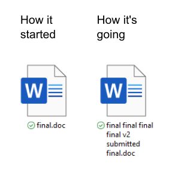
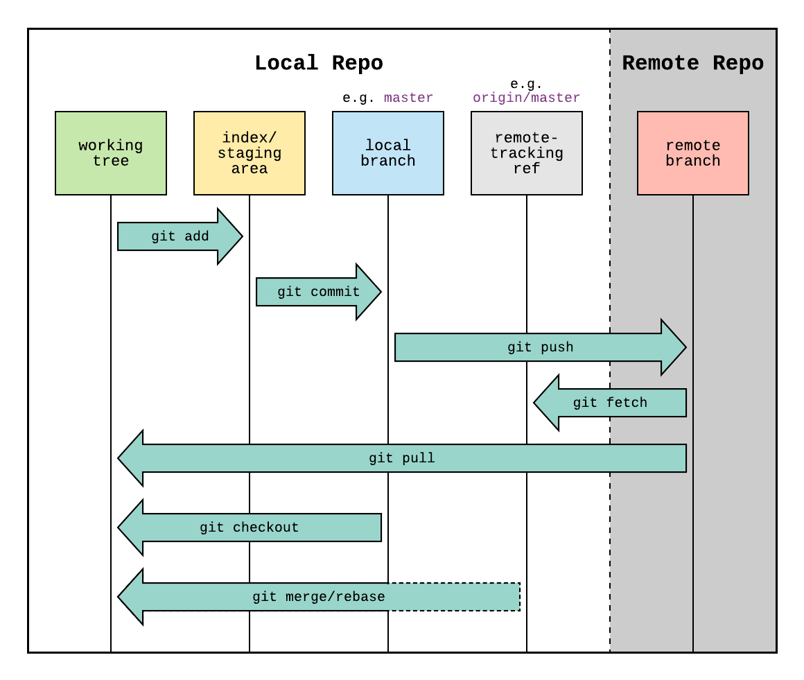

## Workshop Overview

- Introduction to Version Control (today!)
- Basic Git Workflow
- Branching and Merging
- Collaboration on shared folder or GitHub
- Best Practices

Session contains short presentations, live demos, and hands-on tasks


## Training material

-   Clone the repository:

    -   Either download the zip from GitHub by clicking on the `<> Code` button
    -   Or use the terminal

    ``` sh
     git clone https://github.com/ICON-in-R/git-and-github-training.git
     cd git-and-github-training
    ```

## Introduction to Git

Git is a **version control system**, like a powerful "save button" for your files and directories. It helps you track changes and keep a history of your project.

 

::: {.notes}
most popular
different version of CV eg
laptop, PC, work, home
can view all the changes with previous versions
:::
  
------------------------------------------------------------------------

## Git vs. a Text Editor 📝

A text editor saves the entire file at once, giving you only one record unless you make manual copies (e.g., `draft1.doc`, `draft2.doc`).

Git, on the other hand, records the *differences* in files and folders and keeps a historical record of every save. This is a game-changer for developers!


------------------------------------------------------------------------

## Why is Git Useful? 🤔

### For Individuals:

-   Review how your project grows over time.
-   Easily look at or restore file states from the past.

### For Teams:

-   Share and collaborate on projects with other developers.
-   Push your project to platforms like **GitHub**, Bitbucket, or GitLab.

------------------------------------------------------------------------

## Git + GitHub = ❤️

-   **Git** works on your **local** machine.
-   **GitHub** is a **remote** storage facility on the web for your coding projects.
-   You can have private repos and manage access
-   Local interface with [GitHub Desktop](https://desktop.github.com/download/)

------------------------------------------------------------------------

## Example Workflow



::: {.notes}
_working directory_ is where make changes to files - not tracked yet
_staging area_ is where prep changes before committing them - draft space
_local repository_ is project history stored on your computer
_remote repo_ is shared version of the project hosted on the internet or network
_branches_ parallel versions of project
_pull request_ is way to propose changes - review, discuss, merge
:::

## Assignment and Resources 💻

-   Read chapters 1.1 through 1.4 from the **Getting Started** section of [Pro Git](https://git-scm.com/book/en/v2/Getting-Started-About-Version-Control)
-   If you haven’t yet, [install Git](https://git-scm.com/book/en/v2/Getting-Started-Installing-Git)
  - NB macOS should have git pre-installed
-   [Short History for Git and Github](youtube.com/watch?v=1h9_cB9mPT8&list=PLqGj3iMvMa4LFz8DZ0t-89twnelpT4Ilw&index=1)
-   [What is Git and GitHub?](https://content.red-badger.com/resources/what-is-git-and-github)
-   [What is version control?](https://www.atlassian.com/git/tutorials/what-is-version-control)
-   [What is Git?](https://www.atlassian.com/git/tutorials/what-is-git)
